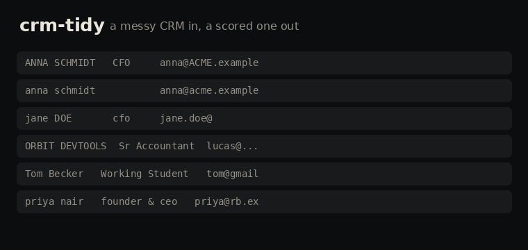

# crm-tidy 🧹

[](https://github.com/ishacm/crm-tidy/actions/workflows/ci.yml)


**A messy CRM in. A clean, scored one out.**

crm-tidy merges duplicates, fixes names and job titles, fills in missing company data, and scores every contact from 0 to 100 against your ideal customer profile, with the reasons written out.

<p align="center"></p>

**👉 [See it in action](https://ishacm.github.io/crm-tidy/)** · **[Open the demo report](https://ishacm.github.io/crm-tidy/demo/report.html)**

---

## What it does, in plain words

1. **You give it a CRM export and your website.** It reads your website and drafts who your ideal customer is.
2. **It tidies up.** Same person twice? Merged. "ANNA SCHMIDT"? Now "Anna Schmidt". "Sr Accountant"? A finance person. Broken email? Flagged for a human.
3. **It tells you who to call first.** Every contact gets a fit score with the reasons, and the best ones go straight to the right owner.

## What you get

- **A clean CSV**, ready to import into HubSpot, sorted by fit.
- **A before and after report:** how complete each field was, what got fixed, and your top 10 contacts.
- **Your ICP as a short file** you can read and edit. The scores follow whatever you put in it.
- **Instant scoring for new leads:** every new inbound lead is scored in under a second, with a short brief for its owner in Slack.

Works with exports from HubSpot, Salesforce, Pipedrive or any spreadsheet.

## Try it in 60 seconds

No account, no API key, no cost:

```bash
git clone https://github.com/ishacm/crm-tidy && cd crm-tidy
pip install -r requirements.txt
CRMTIDY_LLM=mock python -m crm_tidy.run --demo
```

Then open the `report.html` it prints. The demo CRM is 60 deliberately messy rows of fictional people at fictional `.example` companies.

## Use it on your own CRM

```bash
cp .env.example .env                                          # a free Groq key; Apollo and Slack are optional
python -m crm_tidy.run --csv export.csv --website https://your-company.com
# open the icp.yaml it drafted, fix anything that's wrong, then:
python -m crm_tidy.run --csv export.csv --icp icp.yaml
```

---

<details>
<summary><b>How the score works</b></summary>

| Points | For |
|---|---|
| 30 | The industry matches your ICP |
| 25 | The company size is in your range |
| 15 | The country is one you sell to |
| 20 | The person's role matches (finance, founder, operations...) |
| 10 | The seniority matches |

Personal emails (like gmail) cost 10 points, competitors score 0, and students and interns are capped at 20. If something is unknown, the score says so instead of guessing. You can change all of this in `config.yaml`.

</details>

<details>
<summary><b>Filling the gaps: website, Apollo and Clay</b></summary>

Missing company data is filled in order, and each step only gets the companies that still have gaps:

1. **The company's website** (free): the AI reads the homepage and names the industry.
2. **Apollo** (optional, needs `APOLLO_API_KEY`): company size, industry and country, capped at 25 credits per run so a free plan can't be emptied by accident. Free Apollo accounts need a work email for this.
3. **Clay** (optional): crm-tidy writes `for_clay.csv`, you enrich it in a Clay table, export it, and bring it back with `--clay-import clay_export.csv`.

Existing CRM data is never overwritten, and every filled field records where it came from. Apollo's real response format was checked with live data, and that check is part of the tests.

</details>

<details>
<summary><b>Score every new lead automatically with n8n</b></summary>

```bash
cp runs/<date>-<file>/icp.yaml icp.yaml                                   # your reviewed ICP
uvicorn crm_tidy.serve:app --port 8091                                    # n8n on the same machine
CRMTIDY_API_TOKEN=pick-a-long-random-string \
  uvicorn crm_tidy.serve:app --host 0.0.0.0 --port 8091                   # n8n in Docker: always set a token
```

Import [`n8n/crm-tidy.workflow.json`](n8n/crm-tidy.workflow.json) into a self-hosted n8n (free Community Edition). Every new lead from a form, HubSpot or Clay gets scored; tier A leads get a Slack brief, everyone else goes to nurture. Every Monday, the full export is cleaned again and a summary goes to Slack.

</details>

<details>
<summary><b>What it costs (nothing) and what keeps it safe</b></summary>

| Piece | Free option |
|---|---|
| AI | Groq free tier, only used for drafting the ICP and reading company homepages. People's data never goes to the AI |
| Company data | Apollo free plan (capped) and Clay free plan via CSV |
| Automation | n8n Community Edition, self-hosted |

- **Every score explains itself**, and every enriched field shows its source.
- **Your data stays yours.** Real exports and your ICP are git-ignored, so they can't be committed by accident.
- **No secrets in the code.** Keys live in `.env`, and CI fails if anything key-shaped slips in.
- **Before you trust the totals:** spot-check 20 merges and 20 job-title mappings by hand.

</details>

<details>
<summary><b>What's in the repo</b></summary>

```
crm_tidy/    ingest, clean, enrich, score, route, report, icp, serve (API for n8n)
prompts/     ICP drafting and website reading
fixtures/    the fictional demo CRM, homepages and ICP
scripts/     make_demo_data.py, check_secrets.py
n8n/         the importable workflow
docs/        the live page, the demo report and the animation (python docs/make_gifs.py)
tests/       23 tests, run on every push without keys or network
```

</details>

---

<sub>MIT licensed · built by [Isha Chaudhari](https://www.linkedin.com/in/ishachaudhari/) · one of three small open GTM tools: [Kompass](https://github.com/ishacm/kompass), [Earshot](https://ishacm.github.io/earshot/) and [crm-tidy](https://ishacm.github.io/crm-tidy/)</sub>
